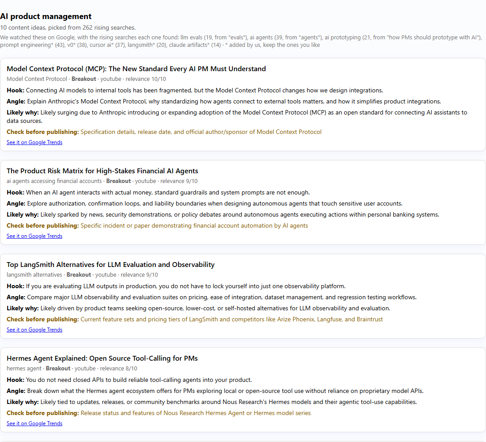
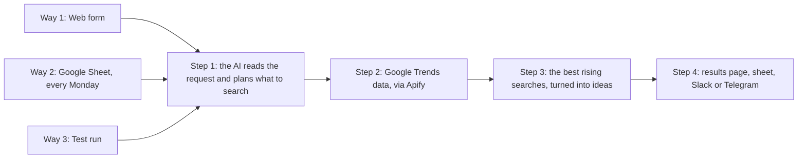
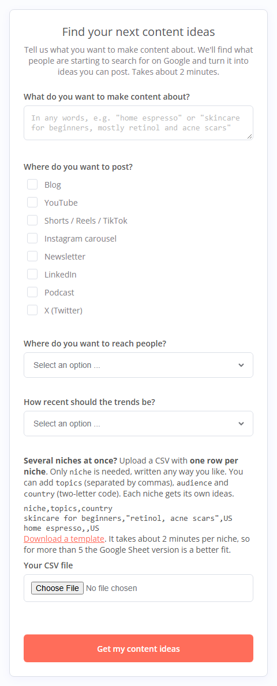
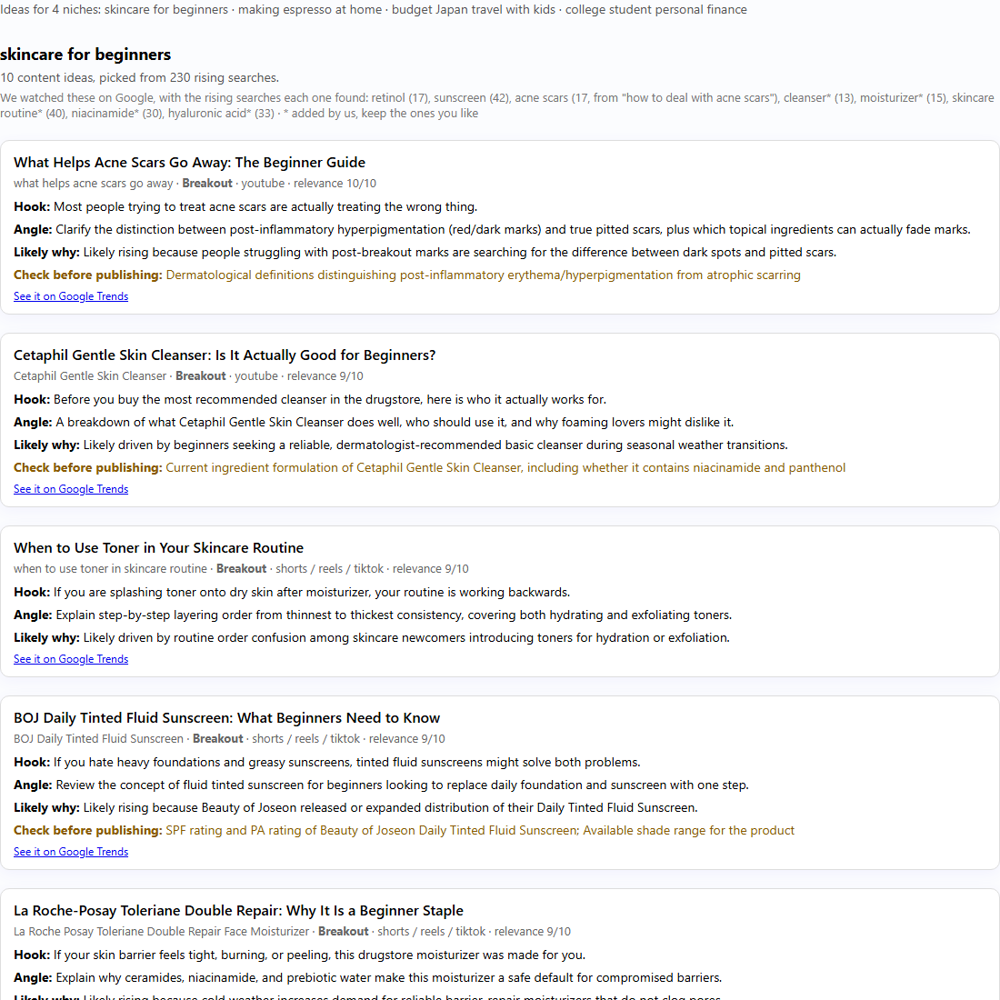

# Niche trend content planner for n8n

Tell it what you want to make content about, in your own words. It finds what people are starting to search for on Google in that niche, and turns it into content ideas you can post this week: a title, a hook, an angle, the likely reason it's rising, and what to fact-check first.



Most "Google Trends to content" workflows use **Trending Now**, which is mostly sports, celebrities and news. This one looks at what's rising **inside your niche**.

**Contents:** [Quick start](#quick-start-about-5-minutes) · [How to use it](#how-to-use-it) · [Reading your results](#reading-your-results) · [Settings](#settings) · [Troubleshooting](#troubleshooting) · [How it works](#how-it-works) · [How it was tested](#how-it-was-tested)

## What you need

- **n8n**, Cloud or self-hosted (tested on 2.44).
- **An Apify account**, for the Google Trends data. The free plan is enough to try it.
- **An AI key.** A free Google Gemini key works, or any chat model n8n supports.
- *Optional:* Google Sheets, Slack or Telegram, for the weekly version.

## Quick start (about 5 minutes)

**1. Import the workflow.** In n8n, create a new workflow, open the **⋯** menu (top right) → **Import from URL**, and paste:

```
https://raw.githubusercontent.com/lakshay-jainn/n8n-niche-trend-content-planner/main/workflow.json
```

You'll see a green **Start here** note, three blue bands on the left (**Way 1–3**, the ways in) and four bands to the right (**Step 1–4**, what every run goes through).

**2. Install the Apify node, if n8n asks.** Click **Install**. It's a verified community node. On n8n Cloud, the instance owner may need to allow verified community nodes in the Admin Panel first.

**3. Connect Apify.** It's in **Step 2**: double-click the **Google Trends** node → **Credential to connect with** → **Create new credential**.
- **n8n Cloud:** click the sign-in button and approve in Apify. Nothing to copy.
- **Self-hosted n8n:** Apify's sign-in isn't available there. In the node, set **Authentication** to **API Key** first, then paste your token from [apify.com](https://console.apify.com) → **Settings** → **API & Integrations**.

**4. Connect the AI.** It's in **Step 1**: double-click **Gemini model** → **Credential to connect with** → **Create new credential**. Get a free key at [aistudio.google.com](https://aistudio.google.com) → **Get API key** → **Create API key**, and paste it into **API Key**. (The same node serves Step 3 too, so you only do this once.)

**5. Try it.** In **Way 3 · Test run**, open **Test input** and write what you'd type in the form, or keep the example. Hover **Run it now** and click its ▶ button. After about 2 minutes, double-click **Weekly summary** (in **Step 4**) to read your ideas. **One row per idea** shows them as a table.

**6. Go live.** Click **Publish** (top right; in older n8n, switch the workflow to **Active**). Then double-click the **Form** node and copy its **Production URL**. That's the link you open yourself or send to a client.

For the weekly Google Sheet version, see [Way 2](#way-2--google-sheet-every-monday).

## How to use it



### Way 1 · Web form

The form asks one thing, **"What do you want to make content about?"**, and people answer however they like:

- `home espresso`
- `skincare for beginners, mostly retinol and acne scars`
- `I make YouTube videos about AI for product managers. Want to cover evals, agents, and how PMs should prototype with AI`

Then, optionally: where they post, which country, and how recent the trends should be. Ideas show on the next page after about 2 minutes.



### Several niches at once (CSV)

On the form, upload a CSV with **one row per niche**. The form explains this right above the upload and links a [template](bulk_template.csv). Only `niche` is needed; leave the first box empty, or use it for one more niche.

| Column | Needed? | What to put in it |
|---|---|---|
| `niche` | yes | What you want to make content about, in any words |
| `topics` | no | Topics you want covered, separated by commas |
| `audience` | no | Who it's for |
| `country` | no | Two-letter code, like `US` or `IN` |

```csv
niche,topics,audience,country
skincare for beginners,"retinol, sunscreen, how to deal with acne scars",people new to skincare,US
home espresso,,people making coffee at home,US
I post short videos about budget travel in Japan for families with kids,,,US
```

Each niche gets its own section of ideas. Four niches took about 2.5 minutes in a live test. For more than 5 niches, or every week, the Google Sheet is a better fit.



### Way 2 · Google Sheet, every Monday

1. Make a Google Sheet with two tabs: **`Keywords`** and **`Ideas`** (leave `Ideas` empty).
2. In `Keywords`, add one row per niche, with the same columns as the CSV above, plus `formats` (where you post) and `active` (`no` pauses a row):

   | niche | topics | audience | country | formats | active |
   |---|---|---|---|---|---|
   | skincare for beginners | retinol, niacinamide | people new to skincare | US | | |
   | home espresso | espresso machine, latte art | | | youtube, blog | |
   | I post short videos about budget travel in Japan for families with kids | | | | | |

3. In **Way 2**, double-click **Read keyword sheet**: connect your Google account and pick the sheet.
4. In **Step 4**, **Add to Google Sheet** is turned off. Select it, press **D** (or right-click → **Activate**), connect Google, and pick the same sheet (tab `Ideas`).
5. *Optional:* turn on **Send to Slack** or **Send to Telegram** the same way, and pick a channel or chat.
6. Publish the workflow. It runs every Monday at 8:00. Each niche is planned on its own and never gets the same idea twice within 8 weeks.

### Way 3 · Test run

Write in **Test input** what you'd type in the form, click ▶ on **Run it now**, and read **Weekly summary**. Test runs don't touch the weekly memory.

## Reading your results

**The line above the ideas** shows every search term it watched, and how many rising searches each one found:

> We watched these on Google: llm evals (19, from "evals"), ai agents (39, from "agents"), prompt engineering* (43), v0* (38)…

- A plain term (`retinol (19)`) is **yours**, kept as you wrote it.
- `(…, from "…")` means it **turned your words into a search term**. Nobody searches "how PMs should prototype with AI", but people do search "ai prototyping".
- `*` means the AI **added** it. Keep the ones you like in your sheet.
- A crossed-out term had **not enough Google data**. That's normal for rare terms, and it costs nothing.
- A note like **"We left out: crypto memes (…)"** means a topic didn't fit the niche.

**Each idea card** shows:
- **The title**, the rising search behind it, its growth ("Breakout" means it grew more than 5,000%), the format, and a relevance score out of 10.
- **Hook**, the opening line, and **Angle**, what to cover.
- **Likely why:** the probable reason it's rising. It's a reasoned guess from search data, not news.
- **Check before publishing:** the facts in the idea that need verifying. Read this before you post.
- **See it on Google Trends:** the chart, so you can judge it yourself.

## Settings

All in the **Defaults** node (Step 1). The defaults are fine to start.

| Setting | What it does | Default |
|---|---|---|
| `ideasPerNiche` | Ideas per niche | 10 |
| `minRelevance` | Only keep ideas the AI scores at least this high (0–10) | 6 |
| `topicsPerNiche` | How many search terms the AI aims to watch per niche | 8 |
| `maxTopicsPerNiche` | The most it may watch, including yours | 12 |
| `includeTopics` | Also use Google's rising related topics, not just searches | true |
| `defaultCountry` | When nobody picked a country. Two-letter code, or empty for worldwide | US |
| `defaultTimeRange` | `now 7-d`, `today 1-m`, `today 3-m` or `today 12-m` | today 1-m |
| `defaultFormats` | When nobody said where they post | blog post, short video, carousel, newsletter |
| `maxKeywordsPerRun` | A safety cap on search terms per run (about 25 niches) | 300 |

To change the style of the ideas (video scripts, newsletter sections, product ideas), edit the instructions in **Prepare AI request** (Step 3).

## Troubleshooting

**There's no sign-in button in the Apify credential.**
You're on self-hosted n8n, where Apify's sign-in isn't available. In the **Google Trends** node, set **Authentication** to **API Key**, then create the credential with your Apify token.

**n8n says the Apify node is unknown, or the Google Trends node has a "?" icon.**
The Apify community node isn't installed. Install it from the prompt or search "Apify" in the nodes panel. On n8n Cloud, the instance owner may need to allow verified community nodes first.

**I got a list of rising searches instead of ideas, with "We couldn't write ideas this time".**
The AI call failed. The note says why: the key or model name needs checking, the account is out of credit, or the service is busy. Fix the **Gemini model** credential and run it again.

**"We couldn't plan topics with AI this time".**
Same cause, at Step 1. The run still searched your words as written, but results are much better once the AI works.

**I ran the test, but where are the ideas?**
Double-click **Weekly summary** in Step 4 (or **One row per idea** for a table). The form shows them on a page; the test run shows them in the editor.

**The form link doesn't work.**
Use the **Production URL**, and publish the workflow first. The Test URL only works while the editor is listening.

**The form shows "Problem submitting response".**
Open **Executions** in n8n and click the failed run: the red node shows what went wrong. Usually a credential isn't connected yet, or the form was sent with nothing in it and no CSV.

**Nothing arrives in my sheet, Slack or Telegram.**
Those nodes start turned off. Select each one and press **D** (or right-click → **Activate**), connect it, and make sure the sheet has an `Ideas` tab.

**"Not enough Google data for …"**
Those terms are too rare in that country. It costs nothing. If a term keeps finding little, replace it in your sheet with something more concrete, like a product, an ingredient, a tool or a common problem.

**"nothing new is rising right now"**
On a weekly sheet run, this means everything rising was already sent to you before. Try again next week, or add more topics.

**It takes a while.**
About 1.5–2 minutes per niche. A form waits for the whole run, so use the sheet for big batches.

## How it works

Every run goes through the same four steps, matching the bands on the canvas.

**Step 1 · Read the request.** The AI (**Plan topics**) reads what was written and returns the niche, the audience (if mentioned) and about 8 search terms. Google Trends works from search terms: for each one, Google reports the searches rising around it, from real search data. So nobody has to guess what's booming; the planner just has to pick good terms. Your own topics are judged rather than trusted or ignored:

| What was written | What the planner did (live runs) |
|---|---|
| "skincare for beginners, mostly retinol for teens and acne scars" | kept **acne scars**; turned "retinol for teens" into **retinol** and **teen acne**; added salicylic acid, niacinamide, cerave… |
| "…AI for product managers. Want to cover evals, agents, and how PMs should prototype with AI" | **llm evals**, **ai agents**, **ai prototyping**; added prompt engineering, rag, cursor ai… |
| "personal finance for college students" + roth ira, a long phrase about saving money, credit card, crypto memes | kept **roth ira**, **credit card**; turned the phrase into **budgeting**; **left out "crypto memes"** and said why |

It matters. Across 8 free-form requests, searching the words as typed found 112 rising searches; the planned terms found 669 (630 in a second round). Two requests found nothing at all as typed.

**Step 2 · Get Google Trends data.** The Apify node runs a Google Trends Actor. Niches with the same country and time range share calls (up to 40 terms each), so a 4-niche batch is one call.

**Step 3 · Pick the best, write ideas.**
- **Junk out.** Trends data in 2026 carries bot and AI-agent traffic: Breakouts like "how to make sushi" under skincare keywords, and prompt-like searches ("explain what niacinamide is and its main benefits for skin health"). Removed: searches that start like an instruction ("explain", "describe", "write", "list", "give me", "tell me", "summarize", "compare", "create", "generate", "provide", "act as"), contain phrases like "and its main benefits" or "why do you think", run past 15 words, or repeat under 3+ unrelated terms. Real long questions and product titles stay.
- **Variants merged** ("trader joe's retinol" = "trader joes retinol"), **ranked by growth**, and **spread across terms**.
- **The AI scores each rising search 0–10** and writes the ideas. Broad names on their own ("Claude", "Serum") score 5 or less. Several searches about the same product type become one idea. Facts stay out of titles and hooks unless they're on the fact-check list.
- **If the AI fails** at either step, the run carries on with a note. Planning falls back to your words; ideas fall back to the list of rising searches.

**Step 4 · Deliver.** The form gets the results page. Sheet and test runs get one row per idea (19 fixed columns: `date, niche, mode, status, idea, angle, hook, format, whyRising, checkBeforePublishing, risingSearch, growth, type, alsoSearchedAs, newThisWeek, yourKeywords, relevance, googleTrends, note`) and a summary for Slack or Telegram. Weekly runs remember what was sent for 8 weeks. Nothing is published automatically.

**Adding another input** (Airtable, Notion, a webhook): each way in has a small adapter that outputs the same rows (`niche, keyword, audience, country, timeRange, formats, source`). Add one that does the same and connect it to **Defaults**.

## How it was tested

On n8n 2.44.6 (self-hosted) with the Apify node 0.9.0 and Gemini 3.8 Flash, against live data. Forms were submitted over HTTP the way the form page does it.

| Test | Result |
|---|---|
| Form, one free-form answer ("I make YouTube videos about AI for product managers…") | Watched llm evals, ai agents, ai prototyping (each labelled with the words it came from) plus five added terms; 10 ideas in about 1.5 minutes |
| Form, 4-niche CSV with the first box empty | 4 niches, 40 ideas, one shared Google Trends call, about 2.5 minutes |
| Form, older keyword-per-row CSV | Read and merged; "how to get rid of acne scars fast" became acne scars |
| Test run, free-form skincare request mentioning acne scars | Kept retinol, sunscreen, niacinamide; 4 of the 10 ideas were about acne scars, as asked |
| Weekly sheet, with an off-niche topic, a paused row, a row without a niche and a free-text niche | Three niches in one call; "crypto memes" left out and named; paused row ignored; missing niche listed as skipped; later runs left out ideas already sent |
| AI failing (invalid key) | Both fallbacks worked, each with its note |
| Offline: the workflow's own code, 6 kinds of input × 4 AI cases | 24 of 24 pass |

The ideas prompt was tuned on 8 niches with 3 runs each. Unchecked numbers in titles and hooks went from 88 to 6 per 240 ideas, made-up personal experience from 2 to 0, and a "why" stated as fact from 111 to 0.

Google Sheets, Slack and Telegram are standard n8n nodes. In these tests the sheet was read from a stand-in node with the same rows, and the outputs weren't connected to real accounts.

## Honest limits

- Google Trends numbers are **relative**: "+3,600%" means fast growth, not big volume.
- **AI ideas can still contain details that aren't true.** That's what the fact-check list is for, and checking it is your job.
- The planner sometimes picks a term few people search. It shows up with a low count.
- What people write goes to your AI provider, along with the rising searches.

## License

MIT. Disclosure: I built the Google Trends Actor this workflow uses.
